# Kite

[](https://github.com/keshavm21/kite/actions/workflows/ci.yml)


**An optimizing compiler for a small GPU kernel language, written in C++17, targeting NVIDIA PTX.**

```kite
kernel saxpy(n: i32, a: f32, x: *f32, y: *f32) {
    var i: i32 = block_idx.x * block_dim.x + thread_idx.x;
    if (i < n) {
        y[i] = a * x[i] + y[i];
    }
}
```
```
$ kitec -O1 saxpy.kite -o saxpy.ptx      # PTX that runs on any NVIDIA GPU via the driver JIT
$ kitec run -O1 saxpy.kite               # run it on the built-in GPU simulator instead
```

```
source ─► lexer ─► parser ─► type checker ─► CFG IR ─► SSA ─► optimizer ─► out-of-SSA ─► PTX ─► GPU
                                               │                                         ▲
                                               └──────► interpreter (correctness oracle) ┘ differential tests
```

<p align="center"></p>

`row_sum` at `-O1`: `r * cols` is loop-invariant, so LICM moves it out of the loop; the interpreter prints the same results at `-O0` and `-O1`. The animation replays real `kitec` output and is generated by `scripts/demo_svg.py` (no recording involved).

## At a glance

- **End to end, on a real GPU.** All 10 example kernels compile to PTX that `ptxas` accepts and produce the same results on a Tesla T4 as the built-in interpreter, at both `-O0` and `-O1`.
- **A real optimizer.** SSA construction, constant folding, copy propagation, GVN, DCE, CFG simplification, loop-invariant code motion, full unrolling of constant-trip loops and strength reduction, all on one IR, with a verifier that can run after every pass.
- **Measured, not claimed.** Shared-memory tiled matmul runs in 2.82 ms at `-O1` against 7.93 ms at `-O0` (1024^3 on a T4), 2.8x faster than Kite's own naive kernel and within 17% of the same kernel compiled by NVRTC. Memory-bound kernels (saxpy, relu) match NVRTC exactly. `-O1` makes no difference there, and the results say so. [Details and caveats](#results).
- **Tested against an oracle.** An IR interpreter simulates the thread grid. `-O0` and `-O1` must print byte-identical results for every example, 119 unit cases and 186 integration tests pass under ASan/UBSan, and a differential fuzzer (random kernels) found no mismatch in more than 10,000 seeds. It also caught every bug I injected to test it.
- **No dependencies.** Hand-written lexer, recursive-descent parser, type checker, IR, dominator analysis, SSA and PTX emitter. No LLVM, no parser generators. Python is used for tests and GPU scripts only.

## Quick start

```bash
# macOS: xcode-select --install && brew install cmake
cmake -B build -DCMAKE_BUILD_TYPE=Release && cmake --build build -j
./build/kitec examples/row_sum.kite --emit=ir -O1     # the optimized IR
./build/kitec examples/row_sum.kite -O1 -o row_sum.ptx
./build/kitec run examples/row_sum.kite -O1           # interpret it with the @spec inputs; prints the @check buffers
./build/kitec examples/row_sum.kite -O1 --stats       # instruction count after every pass
```

Run the tests:

```bash
ctest --test-dir build                                  # unit tests (doctest)
python3 tests/run_tests.py --kitec build/kitec           # golden, error and differential tests
python3 tests/fuzz/fuzz.py -n 500 -j 4                   # random kernels, -O0 vs -O1 vs each pass
```

The CLI: `kitec FILE.kite [-o OUT.ptx] [-O0|-O1] [--emit=tokens|ast|ir|ptx] [--passes=a,b,c] [--disable-pass=NAME] [--print-after-all] [--verify-each] [--stats] [--target=sm_75]`, and `kitec run FILE.kite` to interpret a kernel with the inputs from its `@spec` header.

## From kernel to IR to PTX

`examples/saxpy.kite` at `-O1` (`kitec --emit=ir -O1`, then `kitec -O1`; the PTX is shortened to the kernel body):

```
kernel @saxpy(i32 %n.0, f32 %a.1, ptr.f32 %x.2, ptr.f32 %y.3) {
entry:
  %4 = special i32 ctaid.x
  %5 = special i32 ntid.x
  %6 = mul i32 %4, %5
  %7 = special i32 tid.x
  %8 = add i32 %6, %7
  %10 = lt i32 %8, %n.0
  br %10, if.then.1, if.end.2
if.then.1:
  %11 = load f32 global %x.2[%8]
  %12 = mul f32 %a.1, %11
  %13 = load f32 global %y.3[%8]
  %14 = add f32 %12, %13
  store f32 global %y.3[%8], %14
  jmp if.end.2
if.end.2:
  ret
}
```
```
    mul.lo.s32          %r6, %r4, %r5;
    add.s32             %r8, %r6, %r7;
    setp.lt.s32         %p10, %r8, %r0;
    @!%p10 bra          $L_if_end_2;
    mul.wide.s32        %rd15, %r8, 4;      // element index -> byte offset
    add.s64             %rd16, %rd2, %rd15;
    ld.global.f32       %f11, [%rd16];
    mul.rn.f32          %f12, %f1, %f11;    // .rn on purpose: no fma contraction, so results match the interpreter
    ...
    add.rn.f32          %f14, %f12, %f13;
    st.global.f32       [%rd20], %f14;
```

A loop example: in `row_sum`, `r * cols` does not depend on the loop counter, so LICM moves it out of the loop (see [`docs/IR.md`](docs/IR.md) section 8):

```
if.end.2:
  %14 = mul i32 %8, %cols.1          ; hoisted from for.body.4 by licm
  %acc.21 = copy f32 0.0
  %c.22 = copy i32 0
  jmp for.cond.3
```

## The optimizer

`-O1` runs `remove-unreachable, ssa, {constfold copyprop gvn dce simplifycfg}` until nothing changes (at most 4 rounds), then `{unroll constfold copyprop gvn dce simplifycfg}` the same way, then `licm, gvn, strength, constfold, dce, simplifycfg, out-of-ssa`. `--disable-pass=NAME` removes a pass from `-O1`, which is how the benchmark isolates what each pass contributes. Any list of passes can be run with `--passes=a,b,c`; the pass manager tracks the IR form (lowered, SSA, post-SSA) and rejects a bad order. `--verify-each` runs the verifier after every pass, `--print-after-all` dumps the IR, `--stats` prints instruction counts per pass.

- **constfold:** folds immediates with exact f32 semantics. `x*0.0` and `x+0.0` are *not* folded (NaN and -0.0), `exp` is never folded, and i32 division by zero is never folded.
- **gvn:** dominator-scoped value numbering of pure instructions. Loads are never numbered.
- **licm:** natural loops from back edges, inner loops first. It hoists only instructions that cannot trap and do not touch memory: no loads, no `div`/`rem` (division by zero), no `ftoi` (undefined on NaN). A loop without a preheader is skipped and counted in `--stats`.
- **unroll:** fully unrolls loops of the form `phi i = [imm, pre], [i + imm, body]`, `cmp i, imm` whose body is a single block, when the trip count (found by simulating the induction variable, with i32 wraparound) is at most 64 and the result stays under 400 instructions. The induction values become immediates, so the cleanup passes fold the address arithmetic. It makes the code *bigger* (see `matmul_tiled` below); whether that pays off is measured, not assumed.
- **strength:** `mul i32 x, 2^k` becomes `shl`. Signed `div` by `2^k` does **not** become a shift: `-7 / 2` is `-3` but `-7 >> 1` is `-4`. A unit test pins this.

## Design decisions

- **Locals are virtual registers, never memory.** SSA construction works directly on registers, so there is no alloca/mem2reg stage. Arrays exist only as kernel pointers and `shared` arrays, and every access is `base[index]` on an *element* index; the backend expands it to byte addresses. That keeps the interpreter bounds-checkable and address arithmetic out of the optimizer.
- **One IR in three forms** (lowered, SSA, post-SSA), with a pass manager that tracks the form and rejects a pass run in the wrong one. `-O0` goes straight from lowered IR to PTX; the backend and interpreter accept every form.
- **The interpreter is the oracle, so floats must be bit-exact.** The backend emits `mul.rn.f32` and `add.rn.f32` (explicit rounding forbids fma contraction) and the build uses `-ffp-contract=off`. Then `+ - * /` and `sqrt` agree bit for bit between the interpreter and the GPU, and only `exp` needs a tolerance.
- **Optimizations follow the exact semantics.** `x * 0.0` and `x + 0.0` are not folded for f32 (NaN, -0.0), `exp` is never folded, and i32 division by zero is never folded. Signed `x / 2^k` is not a shift (`-7 / 2` is `-3`, `-7 >> 1` is `-4`). LICM never hoists a load, a `div`/`rem` or an `ftoi`, because hoisting speculates, and those can trap or read memory that changed.
- **ptxas does register allocation.** PTX has unlimited virtual registers, so Kite does none. The cost is that ptxas often removes the redundancy Kite's passes remove, which is why the benchmarks report SASS and registers next to run time.
- **Debug the verifier-first way.** Shrink to the smallest failing kernel, then use `--emit=ir`, `--print-after-all` and `--verify-each`. The verifier checks the IR invariants after every pass in the test runner.

## Results

### What the optimizer does to the code (`results/opt_stats.md`, `python3 scripts/opt_stats.py`)

| example | IR -O0 | IR -O1 | change | PTX -O0 | PTX -O1 | change | regs -O0 | regs -O1 |
|---|---:|---:|---:|---:|---:|---:|---:|---:|
| block_sum | 40 | 37 | -8% | 54 | 51 | -6% | 12 | 13 |
| casts | 30 | 26 | -13% | 42 | 38 | -10% | 13 | 13 |
| collatz_steps | 41 | 44 | +7% | 46 | 50 | +9% | 11 | 12 |
| matmul_naive | 39 | 36 | -8% | 51 | 49 | -4% | 14 | 14 |
| matmul_tiled | 87 | 149 | +71% | 111 | 236 | +113% | 16 | 34 |
| relu | 13 | 12 | -8% | 21 | 20 | -5% | 10 | 10 |
| row_sum | 25 | 23 | -8% | 33 | 32 | -3% | 12 | 12 |
| saxpy | 15 | 14 | -7% | 26 | 25 | -4% | 10 | 10 |
| softmax_rows | 57 | 49 | -14% | 70 | 65 | -7% | 17 | 17 |
| vector_add | 14 | 13 | -7% | 26 | 25 | -4% | 12 | 12 |
| **total** | 361 | 403 | +12% | 480 | 591 | +23% | | |

Instruction counts and `ptxas` registers per thread (from Colab), `-O0` vs `-O1`. Most kernels shrink by 4-14%. Two do not:

- `collatz_steps` gets bigger (+7% IR, +9% PTX): its loop-carried values become phis, and out-of-SSA turns each phi back into copies plus split blocks. There is no copy coalescing yet.
- `matmul_tiled` more than doubles in PTX (111 to 236 instructions) and doubles its registers (16 to 34), because `unroll` fully unrolls the 16-iteration inner loop. That is a code-size cost paid on purpose; the GPU results below say whether it was worth it.

### What it does to the GPU (`results/bench_T4.md`, `python3 gpu/bench.py` on Colab, Tesla T4)

Median of 20 launches; saxpy/relu n = 2^24, softmax 8192 x 1024, matmul 1024^3. Every variant matched the library result. CUDA C is the same kernel through NVRTC with `--fmad=false`.

| kernel | Kite -O0 | Kite -O1, no unroll | Kite -O1 | CUDA C (NVRTC) | library |
|---|---:|---:|---:|---:|---:|
| saxpy | 0.770 ms (262 GB/s) | 0.771 ms | 0.771 ms (261 GB/s) | 0.770 ms | CuPy 1.374 ms |
| relu | 0.571 ms (235 GB/s) | 0.575 ms | 0.575 ms (234 GB/s) | 0.571 ms | CuPy 0.630 ms |
| softmax_rows | 4.35 ms | 3.68 ms | 3.89 ms | 3.77 ms | CuPy 1.33 ms |
| matmul_naive | 9.62 ms (223 GFLOP/s) | 7.90 ms | 7.88 ms (272 GFLOP/s) | 4.69 ms (458 GFLOP/s) | cuBLAS 0.372 ms (5777 GFLOP/s) |
| matmul_tiled | 7.93 ms (271 GFLOP/s) | 4.11 ms (523 GFLOP/s) | **2.82 ms (763 GFLOP/s)** | 2.41 ms (891 GFLOP/s) | cuBLAS 0.402 ms (5338 GFLOP/s) |

What the numbers say:

- **Memory-bound kernels (saxpy, relu): Kite equals NVRTC.** Same time, registers and SASS length (16 instructions), at 73-82% of the T4's 320 GB/s. `-O1` changes nothing: the PTX is smaller, but ptxas already produced the same SASS from `-O0`, and DRAM bandwidth is the limit (`PTX_BACKEND.md` section 11).
- **Loop unrolling is the one optimization that mattered on the GPU: `matmul_tiled` is 31% faster with it (4.11 to 2.82 ms), and 2.8x faster than Kite's own `matmul_naive`.** Without unrolling, Kite's tiled kernel was 1.7x slower than NVRTC's; with it, 1.17x slower. `results/sass_opcodes.md` shows why: Kite `-O1` and nvcc now have the same counts of the loop's instructions (20 `LDS`, 16 `FMUL`, 16 `FADD`, 8 `ISETP`, 3 `BRA`), so nvcc had unrolled that loop and Kite did not. The price is registers: 17 to 34 (nvcc: 36).
- **The remaining 17% gap to nvcc is not explained.** Kite's tiled SASS has a few extra `IMAD`/`IADD3`, and one-off `I2F`/`MUFU`/`F2I`/`IABS` instructions that nvcc's lacks. Those look like a generic signed-division sequence for `(k + 15) / 16` (a division by a power of two that Kite does not strength-reduce, deliberately: see `strength`), but I have not verified that this is the cause or that it matters for run time.
- **matmul_naive: unrolling cannot help, and nvcc is 1.7x faster.** The loop bound `k` is a kernel parameter, so Kite does not unroll. nvcc's SASS for it is 232 instructions against Kite's 40 (58 `LDG` against 2), which is consistent with nvcc unrolling a loop whose trip count is only known at run time. I did not look further.
- **softmax_rows: no conclusion about `-O1`.** All three Kite variants have identical SASS opcode counts (176 instructions, 17 registers). The `-O1` PTX with and without `unroll` is byte-identical here, yet the two runs differ by 6% (3.68 vs 3.89 ms), so run-to-run noise on this kernel is at least that large. The `-O1` vs `-O0` difference (10% here) is within what I'd call noise; an earlier run showed 23%, and I no longer trust that figure. All variants are slow in absolute terms (5-6% of peak) because each thread walks a whole row, so neighbouring threads read addresses `cols` floats apart and nothing coalesces. CuPy's multi-kernel version is 2.8x faster.
- **Tiling works:** Kite's tiled matmul is 2.8x faster than its naive one at `-O1`; both are far behind cuBLAS (66-71% of peak against Kite's 3-9%).

## Testing

- **Differential testing is the core guarantee.** For every example and every file in `tests/exec`, `kitec run -O0` must equal `-O1`, `--passes=ssa` and `--passes=ssa,out-of-ssa` byte for byte. The interpreter does f32 math in `float`, with `-ffp-contract=off`, so it is bit-identical to PTX `mul.rn`/`add.rn`.
- The same interpreter output is compared with a real GPU run (`gpu/check_all.sh`, floats at rtol 1e-5).
- A **fuzzer** (`tests/fuzz`) generates random kernels (loops, branches, loads and stores, i32 and f32) and checks `-O0` against `-O1` and against each pass in isolation, with the verifier on. A clean run over 10,000 seeds found no mismatch. To check the fuzzer itself, four bugs were injected one at a time (LICM hoisting loads, GVN numbering loads, folding f32 `x*0.0` and `x-x`); it caught each within 1500 seeds. CI runs 200 seeds per push.
- The IR verifier runs after lowering and, in the test runner, after every pass.
- Golden files pin the AST, the IR at every form, and the PTX; every PTX goes through `ptxas` (or a structural linter when it is not installed).
- Unit tests (doctest) cover the lexer, parser, sema, lowering, verifier, interpreter, PTX, SSA and each pass.

## Run on a GPU (Google Colab, free T4)

```bash
python3 gpu/run_hello.py                                   # sanity check: hand-written PTX
./build/kitec -O1 examples/softmax_rows.kite -o sm.ptx
ptxas -arch=sm_75 -v sm.ptx -o sm.cubin                    # registers, shared memory, spills
python3 gpu/run_gpu.py examples/softmax_rows.kite sm.ptx > gpu.out
./build/kitec run -O1 examples/softmax_rows.kite > interp.out
python3 gpu/compare.py interp.out gpu.out                  # MATCH

OPT=-O1 gpu/check_all.sh                                   # all examples: compile, run on the GPU, compare with the interpreter
python3 gpu/bench.py                                       # writes results/bench_T4.md (needs CuPy)
python3 gpu/sass_opcodes.py                                # writes results/sass_opcodes.md (needs nvcc, cuobjdump)
```

The GPU scripts need an NVIDIA GPU and CuPy; `ptxas`, `nvcc` and `cuobjdump` come with the CUDA toolkit (on Colab: `export PATH=$PATH:/usr/local/cuda/bin`). Nothing else in the repo needs a GPU.

## Repository map

```
src/frontend   lexer, parser, AST, semantic analysis
src/ir         IR, builder, printer, verifier, AST→IR lowering
src/analysis   CFG, dominators and dominance frontiers, natural loops
src/transform  SSA construction/destruction, optimization passes, pass manager
src/interp     IR interpreter, @spec parser
src/codegen    PTX emitter
examples/      10 kernels: vector ops, ReLU, softmax, reductions, matmul (naive + tiled)
gpu/           GPU runner, comparer, benchmarks (bench.py), SASS opcode report (sass_opcodes.py)
tests/         unit, golden, error, differential tests; fuzz/ (random-kernel fuzzer); hand-checked reference PTX
scripts/       opt_stats.py (instruction-count table), demo_svg.py (the README image)
results/       generated benchmark, SASS and optimization tables
docs/          language, IR, PTX backend, testing and architecture documents
```

## Documentation (read in this order)

| Doc | What it covers |
|---|---|
| [`docs/PROJECT_SPEC.md`](docs/PROJECT_SPEC.md) | What Kite is, why, goals, scope tiers, deliverables, definition of done |
| [`docs/LANGUAGE.md`](docs/LANGUAGE.md) | The Kite language: grammar, types, semantics, static errors |
| [`docs/IR.md`](docs/IR.md) | The intermediate representation: instructions, invariants, worked examples |
| [`docs/PTX_BACKEND.md`](docs/PTX_BACKEND.md) | How IR becomes PTX: lowering table, control flow, floating-point rules |
| [`docs/TESTING.md`](docs/TESTING.md) | Test layers, the `@spec` format, the interpreter, GPU runs on Colab |
| [`docs/IMPLEMENTATION_PLAN.md`](docs/IMPLEMENTATION_PLAN.md) | Nine milestones with algorithms, file lists and acceptance criteria |
| [`docs/architecture.md`](docs/architecture.md) | One-page map of the pipeline and the source tree |

## What I'd do next

1. **Partial unrolling with a remainder loop** for loops whose trip count is only known at run time. nvcc appears to do this (`matmul_naive`: 232 SASS instructions against Kite's 40, and 1.7x faster), and it is the biggest measured gap left.
2. **A shift-right op and signed division by `2^k`.** `x / 16` for signed `x` is `(x + ((x >> 31) & 15)) >> 4`, which needs an arithmetic shift the IR does not have. It may explain the extra division instructions in the tiled kernel's SASS (unverified).
3. Copy coalescing in out-of-SSA, to fix the `collatz_steps` regression, and an address-expression CSE in the backend (`mul.wide` is repeated for every access to the same element).
4. A test-case reducer for fuzzer failures, and shared-memory/`sync()` programs in the fuzzer.
5. SCCP (Wegman-Zadeck) instead of `constfold` plus branch folding, so constants flow through phis and loops.
6. Load CSE within a block, `mad.lo.s32` and `[reg+imm]` addressing, `atomic_add`, and an opt-in `-ffast-math` that emits `fma.rn.f32`, with the precision difference measured.

## License

MIT
